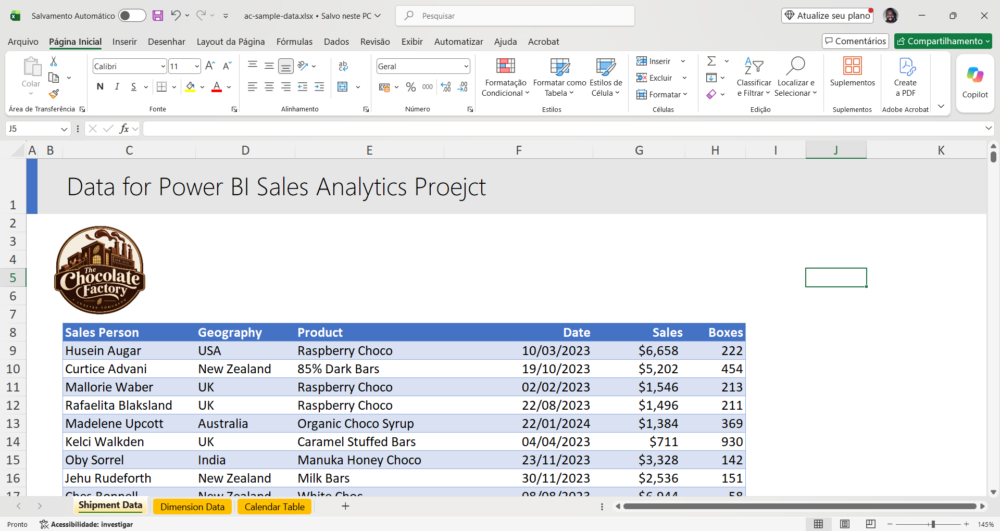
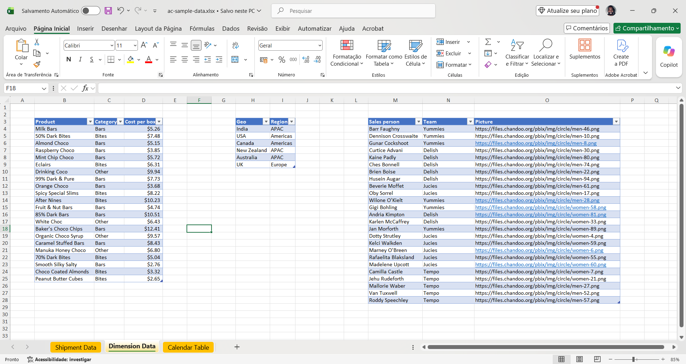
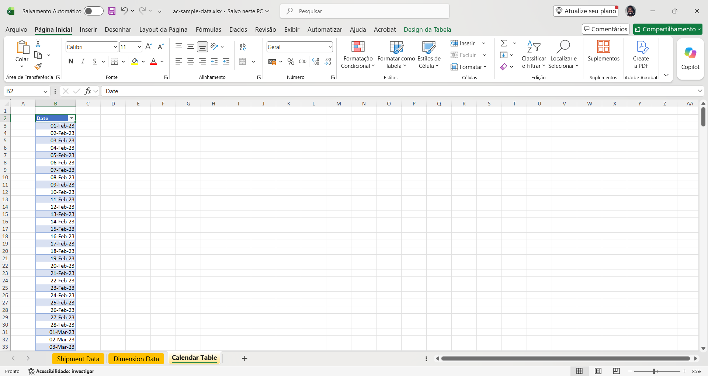
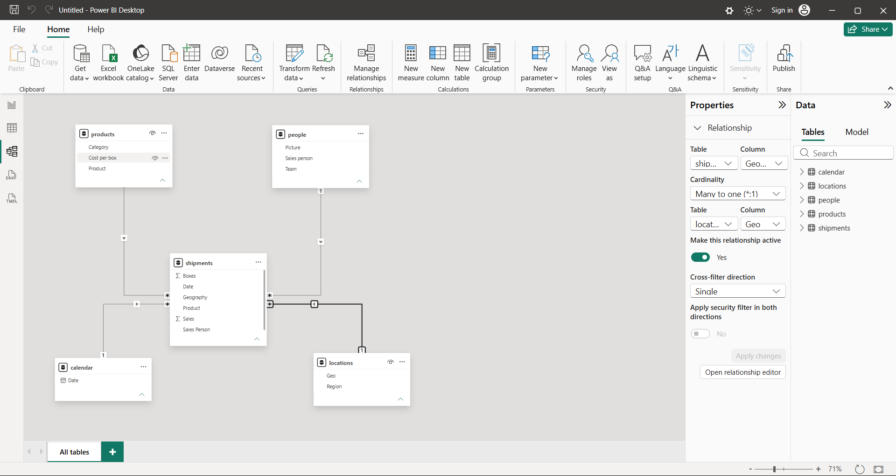
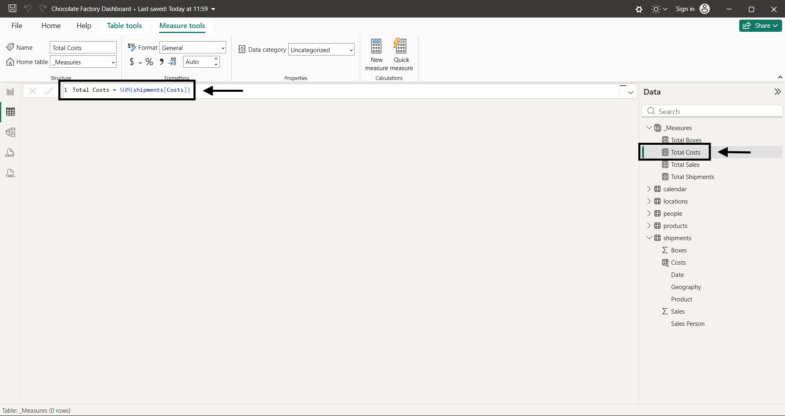
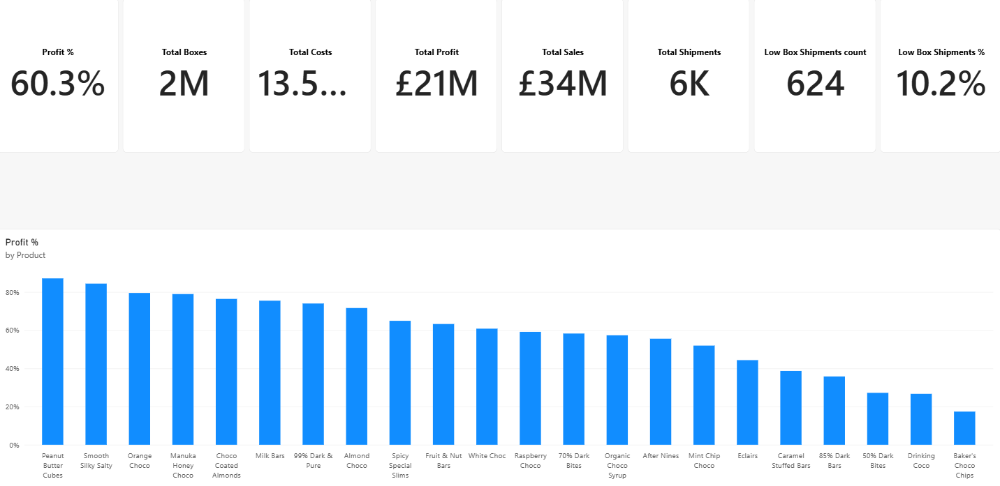
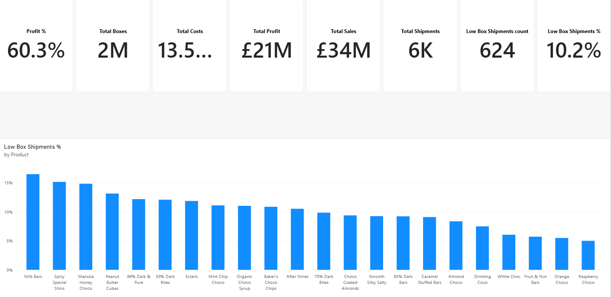
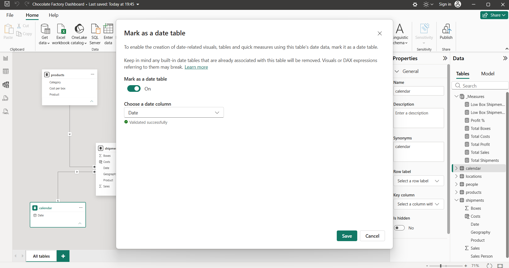
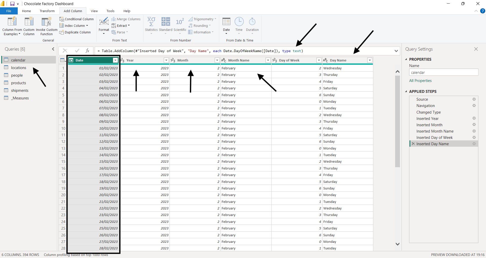

# Sales-Analytics-Dashboard-on-Power-BI
Sales Analytics Dashboard in Power BI provides interactive visualisations and actionable insights into sales performance. Track revenue, profit, sales trends, regional performance, customer behaviour, and product metrics using dynamic KPIs, DAX calculations, and drill-through reports to support data-driven business decisions.

The dashboard enables users to monitor key business metrics such as total revenue, profit, sales growth, customer segmentation, product performance, and regional sales trends. Interactive filters and drill-through capabilities allow stakeholders to explore data at multiple levels and make data-driven decisions with confidence.

## Key Features
- 📊 Interactive sales performance dashboard
- 💰 Revenue, profit, and margin analysis
- 📈 Monthly and yearly sales trend tracking
- 🌍 Regional and geographical sales insights
- 🛍️ Product category and top-performing product analysis
- 👥 Customer segmentation and purchasing behaviour insights
- 🎯 KPI monitoring with dynamic visualisations
- 🔍 Drill-down reports and advanced filtering options

## Technologies Used
- Microsoft Power BI - Main data visualisation platform used for report creation
- Power Query (ETL & Data Transformation for cleaning, reshaping and preparing data)
- DAX (Data Analysis Expressions - used for calculated measures, dynamic visuals and conditioning logic)
- Excel / CSV Data Sources

## Purpose of the project

This repository demonstrates how Power BI can be leveraged to transform business data into meaningful insights, helping organisations optimise sales strategies, identify growth opportunities, and improve overall performance. I will demonstrate the visually engaging dashboards I designed based on a fictitious chocolate factory's business data. The dashboard focus on highlighting the most common KPI's found in the world of business administration.

**1) This is the link for the raw data used in this project: [Sample Data]([./path/to/file](https://github.com/aleriudoms-11/Sales-Analytics-Dashboard-on-Power-BI/blob/main/ac-sample-data.xlsx))**

**2) We are going to start by doing some Data Modelling and Star Schemma development with PowerBI. We are going to use the 3 sets of data available to us:**

**Tab1 --> Shipment Data:**

**Tab2 --> Dimension Data:**

**Tab3 --> Calendar Data:**

**This is how the Star Schemma looks like after I organised and connected the tables in PowerBI:**

**3) Identifying KPIs and and setting up a dedicated (DAX) measure table for Sales Analytics:**

-  Total Sales **Measure1:  Total Sales = SUM(shipments[Sales])**
-  Total Boxes **Measure2: Total Boxes = sum(shipments[Boxes])**
-  Total Shipments **Measure3: Total Shipments = COUNTROWS(shipments)**
-  Total Cost **Measure4: Total Costs = SUM(shipments[Costs])**
-  Total Profit **Measure5: Total Profit = [Total Sales] - [Total Costs]**
-  Profit % **Measure6: Profit % = DIVIDE([Total Profit],[Total Sales])**
-  Low Box Shipments count (Sample boxes < 50) **Measure7: Low Box Shipments count = CALCULATE([Total Shipments],shipments[Boxes]<50)**
-  Low Box Shipments % **Measure8: Low Box Shipments % = DIVIDE([Low Box Shipments count], [Total Shipments])**
-  Month on month changes **Measure9: Coming up in the next few steps**
-  Year on year changes **Measure10: Coming up in the next few steps**

**Here's a screenshot of a DAX measure:**

**4) With all the DAX measures created, now we can start using the Visuals tab in PowerBI to get the first insights:**

-  **Product Peanut Butter Cubes** has a profit margin of 87.1%. It's the most profitable of all products;
-  **Product Baker's Coco Chips** had a profit margin of only 17.4%. It's the least profitable of all products.

--------------------------------------------------------------------------------------------------------------------------------------------------------------------

-  **Product Milk Bars** has the highest Low Box Shipments percentage at 16.5%;
-  **Product Raspberry Choco** has the lowest Low Box Shipments percentage at only 5%.

--------------------------------------------------------------------------------------------------------------------------------------------------------------------

**5) Time intelligence calculations in Power BI: Month-on-Month & Year-on-Year changes:**

Before we do these types of calculations, we need to setup certain things in our data model. 

On the Model View, select the Calendar Table, right click on it and use the "Mark as Date Table" option. This tells PowerBI that this is our Date Table and should be used for all the following time intelligence calculations:

Now we are going to use Power Query (Transform Data) to add a few columns to our original Date Table:

Ok, now we are ready to perform our first Month-on-Month calculations:

